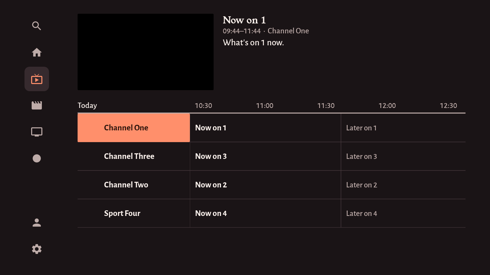
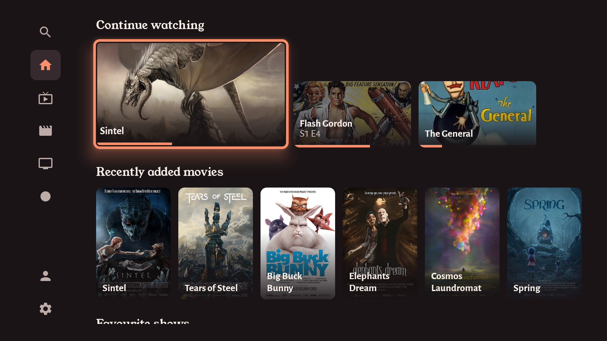
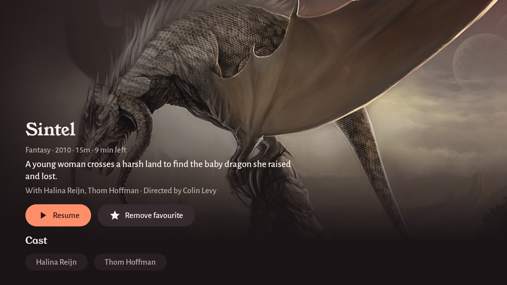
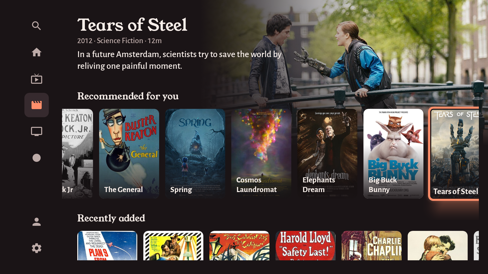
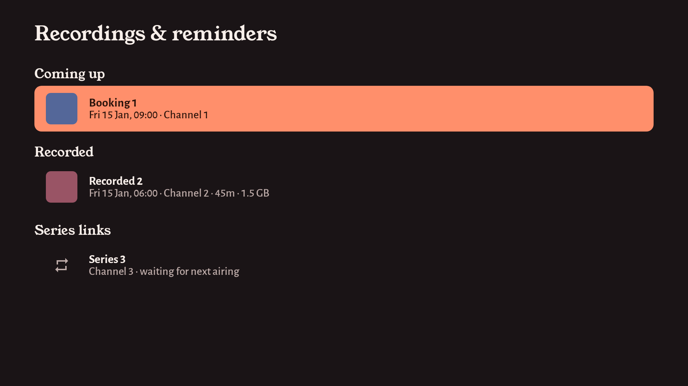
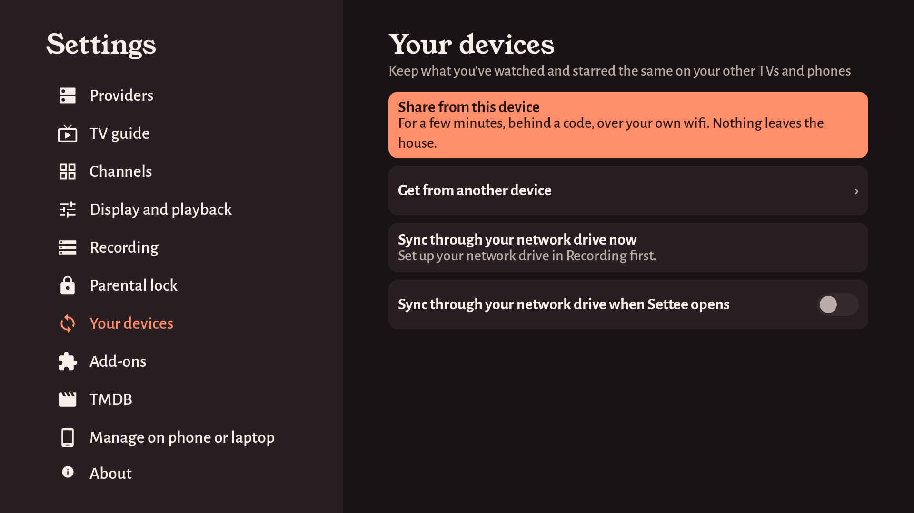
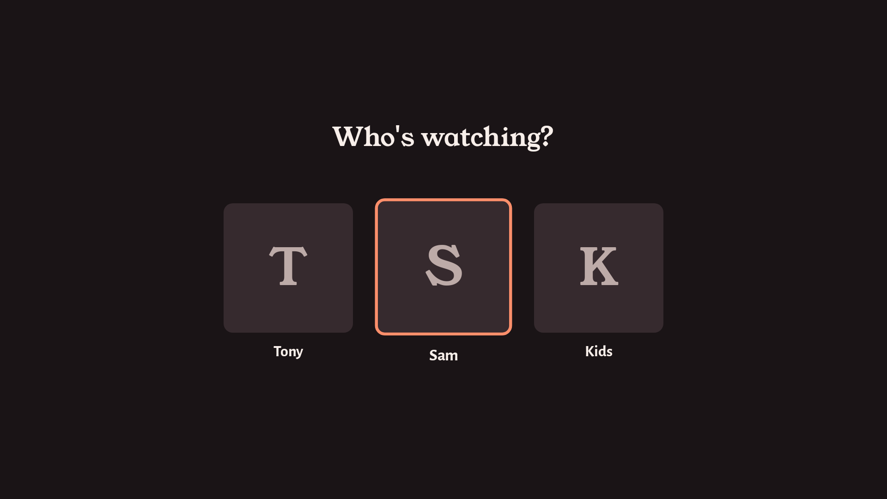
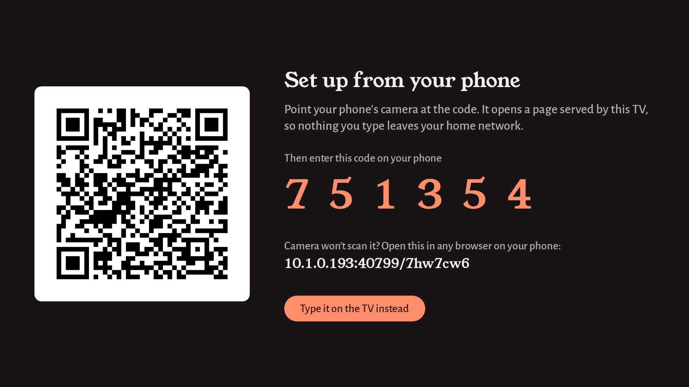
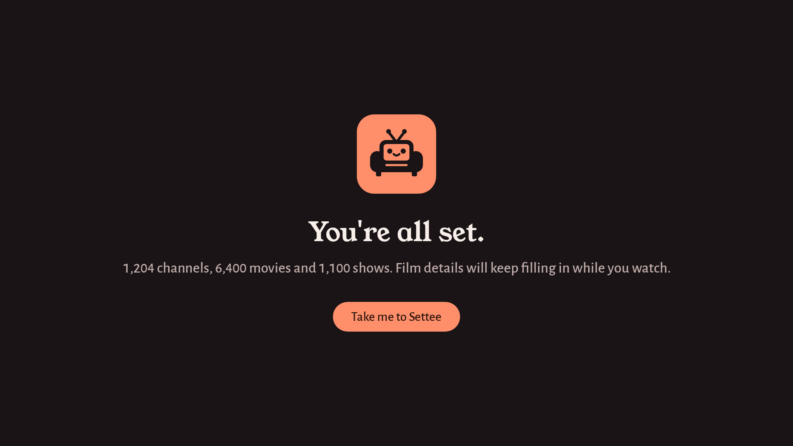

# Settee

**A calm, comfortable IPTV player for a Fire TV Stick. It also runs on Android TV, phones and tablets.**

No account, no subscription, and no server between you and your provider.

[](https://github.com/neutraltone/settee/actions/workflows/build.yml)
[](LICENSE)



Settee plays the TV you already pay for. It doesn't supply channels, so you start by adding your
provider, and everything you watch, favourite and record stays on your own devices.

It's built for a remote first: every screen works with the D-pad, at ten feet, on a small Fire TV
Stick. Touch works too.

## What it does

**Watching**

- **Home** opens on Continue Watching, your favourite channels, shows and movies, and what's been
  added recently, with the channel you last watched playing quietly at the top.
- **Live TV** has a guide you move around by programme, categories in a sidebar, and a banner that
  shows what's on and what's next when you change channel.
- **Movies and Shows** have big artwork, a row for every genre and recommendations based on what
  you've watched. A film or show is listed once, with a Quality pill when your provider has more
  than one version.
- **Film and show pages** show the cast, and each person opens a page of everything they're in.
  Settee fetches these details from TMDB with your own free key.
- **The player** resumes where you left off, plays the next episode on its own, and keeps your
  subtitle language from one title to the next. If a film has no subtitles, Settee can find some
  on OpenSubtitles and let you adjust their timing.
- **Catch-up** where your provider offers it, live pause, a sleep timer and picture-in-picture.

**Recording and reminders**

- Record to the device, a USB drive or a drive on your network. Book from the guide, or record a
  whole series, and play recordings back with full seeking.
- Reminders tell you when a programme is about to start, and can switch to it for you.

**Everyone in the house**

- **Profiles**, each with its own Favourites, watch progress and Continue Watching. Settee asks
  who's watching when it opens.
- **A parental lock** that hides the categories you choose behind a PIN.
- **Your devices** keep what you've watched and starred the same on every TV and phone in the
  house. They share it over your own wifi or Tailscale, or through your network drive, never
  through a server of ours.

**Setting up**

- Add your provider from your phone: scan the QR code on the TV and type the details there
  instead of with the remote.
- Xtream Codes logins, M3U and M3U8 playlists, and Stalker portals, plus Stremio add-ons for
  movies and shows. You can add more than one provider.
- The guide comes from your provider, or from a free XMLTV guide matched to your channels by name.
- Settee updates itself, and tells you what's new afterwards.
- The interface is in around 30 languages, with English wherever a translation hasn't caught up.

## Screenshots

Drawn by Settee's screenshot tests. The films are the Blender Foundation's open films (CC BY) and
classics whose posters are in the public domain, from Wikimedia Commons. The
[credits](app/src/test/resources/readme/CREDITS.md) list each one.

| Home | A film |
| :---: | :---: |
|  |  |
| **A show** | **Movies** |
|  |  |
| **Recordings** | **Your devices** |
|  |  |
| **Who's watching?** | **Setting up from your phone** |
|  |  |



## What it won't do

- **No servers, no web dashboard, no account.** Your provider details never leave your devices,
  and syncing happens directly between them or through your own network drive. See
  [docs/ARCHITECTURE.md](docs/ARCHITECTURE.md) for why, and [docs/PRIVACY.md](docs/PRIVACY.md) for
  what Settee keeps and where.
- **No channels.** Settee is a player. You bring a service you already pay for.

## Install

Download `settee.apk` from [the latest release](https://github.com/neutraltone/settee/releases/latest).
`https://github.com/neutraltone/settee/releases/latest/download/settee.apk` always serves the
newest version. Once it's installed, Settee offers each new release itself.

### Fire TV Stick

1. Install **Downloader** (by AFTVnews) from the Amazon Appstore.
2. Let it install apps: **Settings → My Fire TV → Developer Options → Install unknown apps →
   Downloader → On**. If Developer Options is missing, open **Settings → My Fire TV → About** and
   press Select on the device name seven times.
3. Open Downloader, type the code **6405610** into its address box (or `aftv.news/6405610`, or the
   full address above), then **Go**. When the download finishes, choose **Install**, then
   **Delete** to free the space.

Every release is built by GitHub Actions from a tagged commit, so you can check the APK against
the source. See [docs/RELEASING.md](docs/RELEASING.md).

## Build it yourself

```bash
git clone https://github.com/neutraltone/settee.git
cd settee
./gradlew assembleDebug
```

You need JDK 17 or newer and the Android SDK (API 37), which Android Studio provides. The debug
APK lands in `app/build/outputs/apk/debug/`. It's called Settee Debug, carries a DEBUG badge, and
installs as `uk.neutraltone.settee.debug` beside a release build without touching its data.

Run the tests:

```bash
./gradlew test
```

[CLAUDE.md](CLAUDE.md) has the full list of commands and checks, and
[docs/LOOK.md](docs/LOOK.md) describes how Settee looks and speaks.

## Where it came from

Settee started as a fork of [OpenTV](https://github.com/opentvproject/opentv), a GPL-licensed IPTV
player, and has gone its own way since. It has its own name, look, application ID and updates, and
installs alongside OpenTV rather than over it. The licence
and the OpenTV contributors' copyright in each file stay as they are.

Nothing in OpenTV or Settee was decompiled or copied from another IPTV app. The code was written
from public specifications (the Xtream Codes request format, the XMLTV and M3U formats, the Kodi
catch-up tags) and from how other apps *behave*, never from their source.

## Licence

[GPL-3.0-or-later](LICENSE), inherited from OpenTV.

Settee bundles two typefaces, Young Serif and Alegreya Sans, unmodified. They aren't covered by
the GPL: they're under the [SIL Open Font License 1.1](app/src/main/assets/licences/FONTS.md), and
their licences ship in the app, where About shows them.

## Legal

Settee is a media player, like VLC. It ships with no channels, no playlists and no links to any.
What you point it at, and whether you're entitled to, is between you and your provider.
